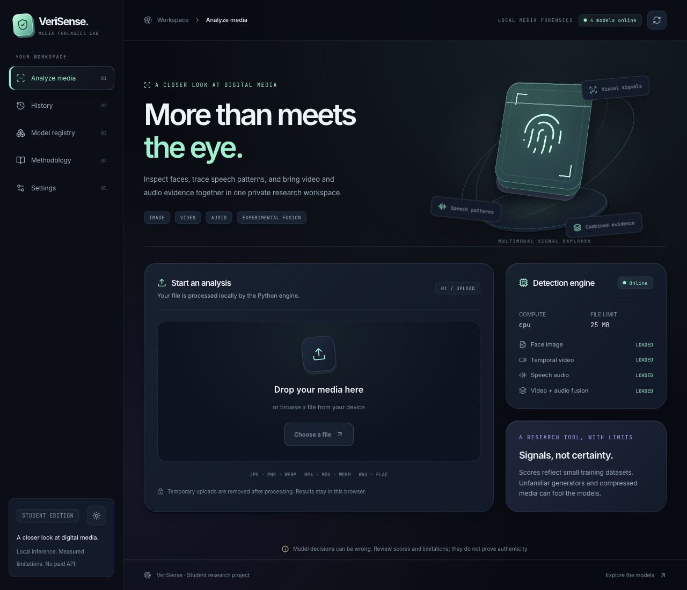
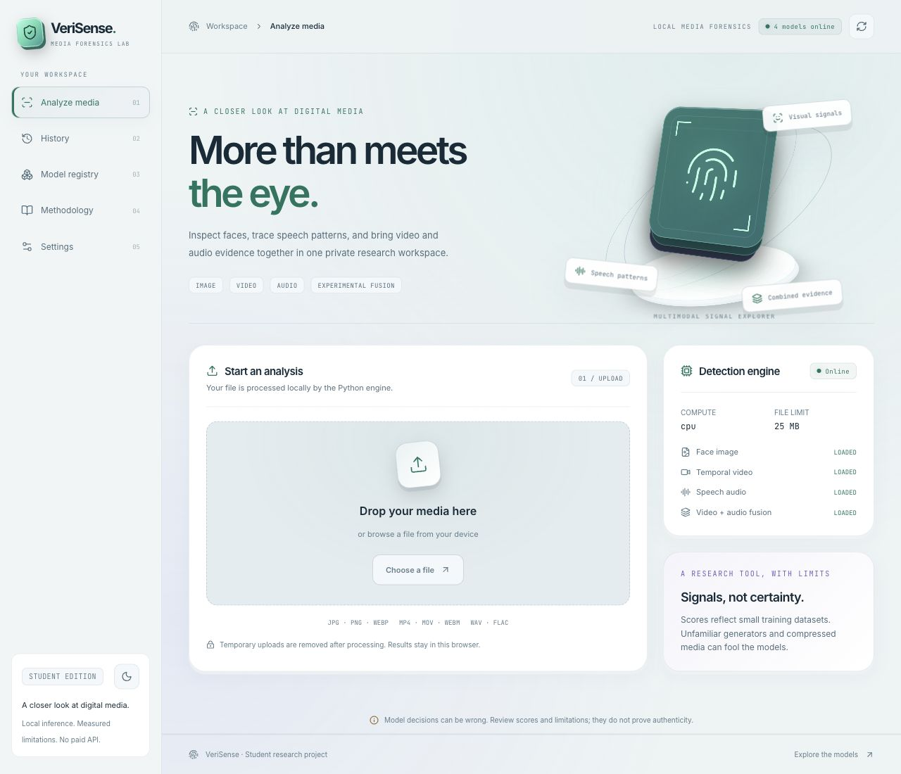
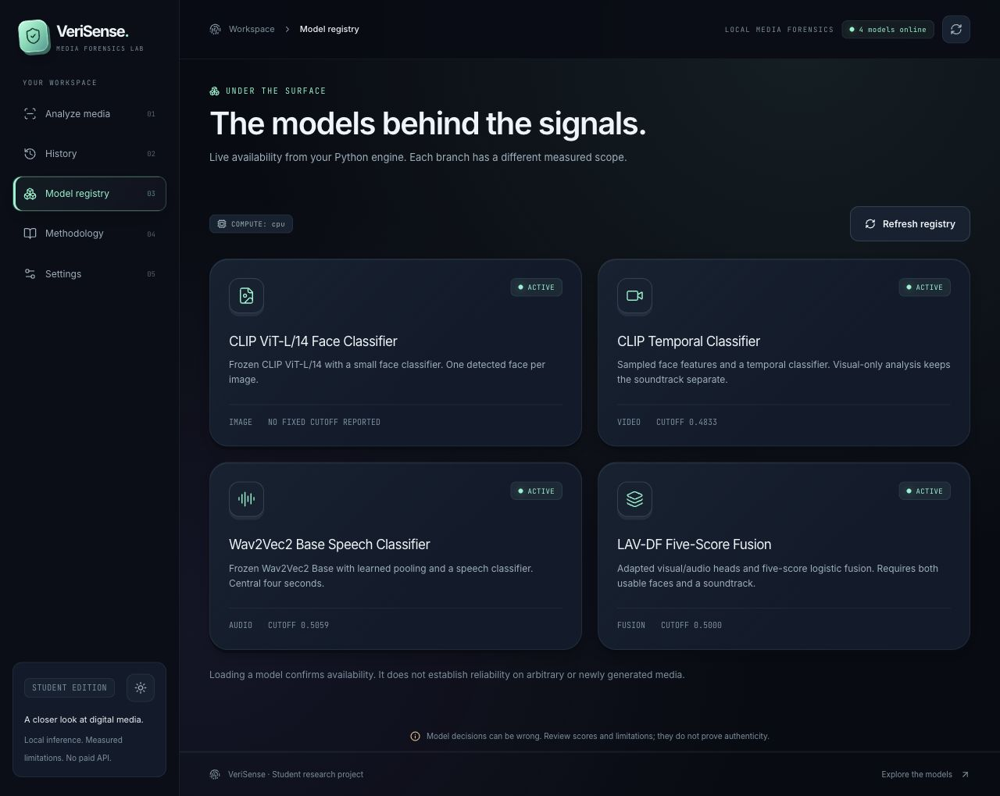
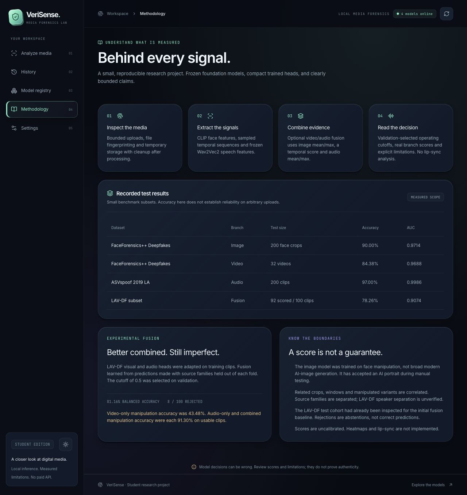
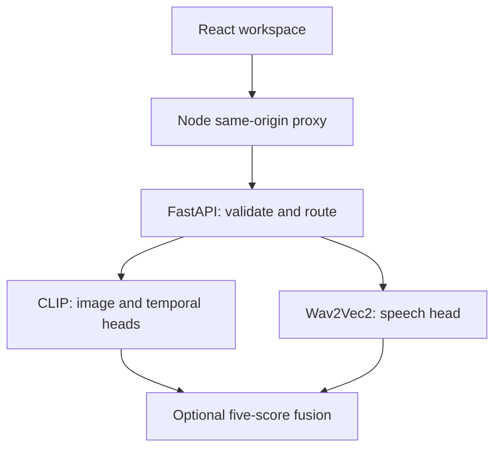

<div align="center">

# VeriSense

### Multimodal deepfake detection, on your own machine.

Inspect facial imagery, temporal video signals, and speech with a local inference engine and an interactive media-forensics workspace.

**React · TypeScript · FastAPI · PyTorch · CLIP · Wav2Vec2**

[Quick start](#quick-start) · [Screenshots](#screenshots) · [Architecture](#architecture) · [Evaluation](#evaluation) · [API](#api) · [Limitations](#limitations)

</div>



> **Project status:** Experimental research prototype. Trained image, video, audio, and fusion branches are integrated. Benchmark results describe small, specific datasets; they do not establish production readiness or authenticity of arbitrary media.

## Overview

VeriSense brings three media modalities into one workspace. Upload an image, video, or speech clip, inspect the model's scores and warnings, and save a report. Optional fusion combines visual and audio evidence from a video using a trained classifier.

- **Local inference:** The browser connects to a local Python engine through a same-origin Node proxy. No paid inference API or API key is required.
- **Four model branches:** Standalone face-image, temporal-video, and speech-audio detectors, plus experimental video/audio fusion.
- **Inspectable results:** Branch scores, sampled timelines where available, processing time, model metadata, warnings, and file fingerprints.
- **Practical workspace:** Drag-and-drop uploads, native media previews, browser-local analysis history, report viewing and printing, and live model availability.
- **Responsive design:** Light and dark themes, a pointer-responsive CSS 3D scanner, keyboard focus states, and reduced-motion support.
- **Explicit failures:** Unavailable models and insufficient evidence produce errors rather than simulated verdicts.

## Screenshots

Actual app captures with the local Python backend connected on CPU and all four model branches loaded. The model registry shows live availability and saved operating cutoffs. The methodology table displays recorded benchmark results; these screenshots do not represent a new inference or accuracy evaluation.

<details>
<summary><strong>Light theme — analysis workspace</strong></summary>



</details>

<details>
<summary><strong>Model registry — all four branches active</strong></summary>



</details>

<details>
<summary><strong>Methodology — processing stages, evaluation, and limitations</strong></summary>



</details>

## Quick start

### Prerequisites

- A Node.js release compatible with Vite 8; Node.js 22.12+ is a suitable baseline.
- Python **3.12**, `pip`, and a virtual environment.
- Exported VeriSense checkpoints; weights and datasets are excluded from Git.
- Internet access for the first backbone download, followed by enough disk space for model caches. The CLIP backbone alone requires roughly 2 GB.
- CPU execution is supported. A compatible GPU can accelerate inference.

Run every command below from the repository root unless stated otherwise.

### 1. Install dependencies

```bash
npm ci
python3.12 -m venv .venv
source .venv/bin/activate
python -m pip install -r verisense/requirements-api.txt
```

The API requirements install inference dependencies. Training uses the separate `verisense/requirements.txt`. FFmpeg decodes video soundtracks; `imageio-ffmpeg` provides a portable executable when a system installation is unavailable.

### 2. Install the trained checkpoints

Place your exported files in this layout:

```text
verisense/checkpoints/
├── image_head.pt
├── video_best.pt
├── audio_head.pt
└── lavdf/
    ├── image_lavdf_head.pt
    ├── audio_lavdf_head.pt
    ├── video_best.pt
    └── fusion_best.pt
```

The standalone heads remain separate from the LAV-DF-adapted heads. Fusion startup verifies checkpoint provenance and preprocessing compatibility. Only load trusted checkpoints.

For the existing `VeriSense_fusion_models.zip` export, extract its `lavdf/` directory into `verisense/checkpoints/`. The original three standalone checkpoints must already be present. Keep the exported metrics files alongside the weights for reference.

### 3. Start the Python engine

```bash
npm run api
```

The API listens on `http://127.0.0.1:8000`. First startup may download frozen backbones. Once those files are cached, offline startup is available:

```bash
HF_HUB_OFFLINE=1 TRANSFORMERS_OFFLINE=1 npm run api
```

### 4. Start the workspace

In a second terminal:

```bash
npm run dev
```

Open [localhost:3000](http://localhost:3000). Verify the engine status and Model registry before uploading media.

### 5. Verify model availability

```bash
curl http://127.0.0.1:8000/health
```

With all four branches loaded, the response includes:

```json
{
  "status": "ok",
  "device": "cpu",
  "active_branches": ["image", "video", "audio", "fusion"],
  "missing_checkpoints": [],
  "version": "1.0.0"
}
```

Actual availability depends on installed checkpoints, cached backbones, and successful initialization. Inspect startup logs if a branch is missing.

## Using the workspace

1. Drop a supported file into **Analyze media**, or choose one from your device.
2. Preview the media. For a video with speech, enable **Combine video and audio (experimental)** to use fusion; disable it for visual-only analysis.
3. Run analysis and inspect the verdict, individual scores, and warnings together.
4. Use **History** to revisit locally saved result metadata or open the report for printing.

| Input | Supported formats | Constraints |
|---|---|---|
| Image | JPG, JPEG, PNG, WEBP, BMP | Exactly one detected face; maximum 25 MB |
| Video | MP4, MOV, AVI, WEBM, MKV | Up to 30 seconds; maximum 25 MB; usable face samples required |
| Speech audio | WAV, FLAC | Mono/stereo, 8–192 kHz, up to 30 seconds; maximum 25 MB |
| Fusion | Supported video with speech | At least four usable single-face samples and non-silent audio |

Standalone audio scores the central four seconds; shorter clips are repeated. Fusion uses windowed audio and sampled faces according to its frozen preprocessing configuration. A successful file decode alone does not guarantee sufficient evidence for a decision.

## Architecture



The visual and speech backbones are frozen. Compact trained heads perform classification; the fusion model consumes image mean/max, temporal score, and audio mean/max. Fusion shares the loaded backbones and restores its learned scaling, weights, and validation-selected cutoff from `lavdf/fusion_best.pt`.

Uploads are bounded, fingerprinted, and stored temporarily for processing, with cleanup afterward. History stores result metadata in the browser; original media is not a durable history attachment. Backbone downloads require an initial network connection. Scores are uncalibrated model outputs, not verified probabilities of authenticity.

## Evaluation

Recorded results use different datasets, units, and cohorts. They should **not** be compared as a ranking of the branches.

| Branch | Dataset | Evaluation size | Accuracy | ROC AUC |
|---|---|---|---:|---:|
| Image | FaceForensics++ Deepfakes subset | 200 face crops | 90.00% | 0.9714 |
| Video | FaceForensics++ Deepfakes subset | 32 videos | 84.38% | 0.9688 |
| Audio | ASVspoof 2019 LA subset | 200 clips | 97.00% | 0.9986 |
| Fusion | LAV-DF subset | 92 scored / 100 clips | 78.26% | 0.9074 |

### Fusion test detail

The frozen fusion cutoff is **0.5**. Balanced accuracy was **81.16%**, with **92% coverage**. Eight rejected clips received no decision and are excluded from scored-clip accuracy.

| Manipulation category | Accuracy on usable clips |
|---|---:|
| Audio-only | 91.30% |
| Audio and video | 91.30% |
| Video-only | 43.48% |

Fusion training used out-of-fold predictions with related source families kept together. The test cohort had previously been inspected for the initial fusion baseline, so it is not a pristine, never-inspected benchmark. Speaker separation is unverified, and related frames/windows are correlated. Visual-only manipulation remains a substantial weakness.

See [research documentation](verisense/README.md), [training workflow](verisense/COLAB_DEMO.md), and [detailed limitations](verisense/LIMITATIONS.md).

## API

| Method | Endpoint | Purpose |
|---|---|---|
| GET | `/health` | Device, service status, loaded branches, and missing checkpoints |
| GET | `/api/models` | Live model registry and operating cutoffs |
| POST | `/api/analyze` | Multipart `file` upload for standalone analysis |
| POST | `/api/analyze?use_fusion=true` | Combined analysis of a video with usable visual/audio evidence |

Interactive API documentation is available at [localhost:8000/docs](http://localhost:8000/docs) while the engine is running.

```bash
curl -X POST http://127.0.0.1:8000/api/analyze \
  -F 'file=@/absolute/path/to/face.jpg'

curl -X POST 'http://127.0.0.1:8000/api/analyze?use_fusion=true' \
  -F 'file=@/absolute/path/to/speech-video.mp4'
```

Responses include `verdict`, `confidence`, branch `scores`, model metadata, processing time, and optional warnings and timeline data. `confidence` is an uncalibrated decision score. Unsupported or insufficient evidence can return 422; unavailable models return 503; an unreachable upstream returns 502 through the Node proxy.

## Configuration

| Setting | Default | Purpose |
|---|---|---|
| `PORT` | `3000` | Node workspace server port |
| `BACKEND_URL` | `http://127.0.0.1:8000` | Node proxy's upstream; HTTP required |
| `VITE_API_BASE_URL` | Empty | Public frontend API address; empty uses the same-origin proxy |
| `VERISENSE_IMAGE_CHECKPOINT` | `verisense/checkpoints/image_head.pt` | Image checkpoint override |
| `VERISENSE_VIDEO_CHECKPOINT` | `verisense/checkpoints/video_best.pt` | Temporal checkpoint override |
| `VERISENSE_AUDIO_CHECKPOINT` | `verisense/checkpoints/audio_head.pt` | Audio checkpoint override |
| `VERISENSE_FUSION_CHECKPOINT` | `verisense/checkpoints/lavdf/fusion_best.pt` | Fusion checkpoint override |

Set shell environment variables for server overrides. Vite also reads `.env.local` for frontend values; see [.env.example](.env.example). `VITE_` values are public and must never contain secrets. Settings can save a browser-specific API endpoint; leave it empty for the proxy.

### Serving a production frontend build locally

```bash
npm run build
NODE_ENV=production npm start
```

Start the Python API separately. The Node server serves `dist/` and proxies inference requests; both launch scripts bind to loopback. This is a local serving configuration, not a verified public deployment. Authentication, TLS termination, access controls, rate limiting, operational monitoring, and deployment hardening are required before exposing it beyond a trusted machine.

## Development and verification

```bash
npm test
npm run lint
npm run build
```

Run runtime-focused backend tests from the repository root:

```bash
source .venv/bin/activate
python -m pip install pytest httpx
python -m pytest verisense/tests/test_api.py \
  verisense/tests/test_preprocessing.py \
  verisense/tests/test_audio_inference.py \
  verisense/tests/test_fusion_inference.py \
  verisense/tests/test_face_extractor.py -q
```

For the full research suite, install `verisense/requirements.txt` into a suitable research environment, then run `python -m pytest verisense/tests -q`. It requires additional training/evaluation dependencies, including pandas and scikit-learn. Contract tests and controlled model tests verify software behavior; detection accuracy requires trained weights and labeled evaluation media. Some tests skip when optional assets are unavailable.

## Troubleshooting

| Symptom | Action |
|---|---|
| Engine offline / proxy 502 | Start `npm run api`, inspect its logs, and check `/health`. Confirm the saved Settings endpoint is correct. |
| A model is unavailable | Check the checkpoint layout and startup logs; inspect `/api/models`. |
| First startup stalls on downloads | Allow initial backbone downloads, or use offline mode only after the cache is complete. |
| `cv2.CascadeClassifier` is missing | Remove overlapping OpenCV distributions, then reinstall the single pinned `opencv-python-headless==4.11.0.86` package from the API requirements. |
| Fusion rejects a silent video | Disable combined analysis to request visual-only scoring. |
| Image rejected for face count | Use an image containing exactly one clearly visible face. |
| CPU analysis is slow | Use short clips within the limits and allow the request to finish. |

## Repository layout

```text
src/                    React workspace, components, and API client
server.ts               Local server and streaming API proxy
tests/                  Frontend/API contract tests
docs/screenshots/       Actual app captures used in this README
verisense/
  backend/              FastAPI, validation, and inference orchestration
  src/                  Model, preprocessing, and training modules
  configs/              Research configuration
  scripts/              Dataset preparation, adaptation, and evaluation
  tests/                Backend and research tests
  checkpoints/          Local exported weights (excluded from Git)
```

Local `mentor_demo/` media and `artifacts/` exports are preserved and excluded from Git. The interface uses CSS geometry, native media playback, and SVG charts without a WebGL engine.

## Limitations

- This is a research prototype, not a forensic certification tool. Verdicts do not prove whether media is authentic.
- The image detector targets face manipulation, not general modern AI-generated imagery. It has accepted an AI portrait during manual testing.
- Small benchmark subsets, correlated samples, and unverified speaker separation limit generalization claims.
- Video-only manipulation is a known weak category in the current fusion experiment.
- Scores and uncertainty margins are uncalibrated. Heatmap explanations and lip-sync detection are not implemented.
- The local application has not undergone a public-deployment security review or broad hardware validation.

## Licensing and data

No project license is declared here. Check repository licensing before redistribution. Pretrained backbones and research datasets retain their respective licenses and access terms; obtain datasets from their authorized sources and review those terms separately.
